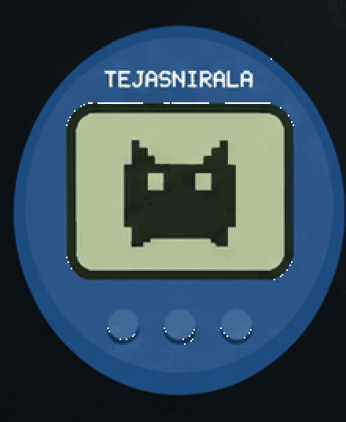

<!--
## Hi there 👋
**tejasnirala/tejasnirala** is a ✨ _special_ ✨ repository because its `README.md` (this file) appears on your GitHub profile.

Here are some ideas to get you started:

- 🔭 I’m currently working on ...
- 🌱 I’m currently learning ...
- 👯 I’m looking to collaborate on ...
- 🤔 I’m looking for help with ...
- 💬 Ask me about ...
- 📫 How to reach me: ...
- 😄 Pronouns: ...
- ⚡ Fun fact: ...
-->

  <table border="0" cellpadding="0" cellspacing="0" width="100%">
    <tr>
      <td align="center" width="42%" valign="middle">
        
      </td>
      <td width="58%" valign="middle">
        <h3><code>CODE PET · TYPESCRIPT TYPE</code></h3>
        <h1>Curious, always.</h1>
        
<em>Building things, learning things. Could use a commit.</em>

         
        <table border="0" cellpadding="5" cellspacing="0" width="100%">
          <tr>
            <td width="24%"><strong>MOOD</strong></td>
            <td>▰ ▰ ▰ ▰ ▰ ▰ ▰ ▱ ▱ ▱</td>
          </tr>
          <tr>
            <td><strong>FOCUS</strong></td>
            <td>Stowwd · product engineering</td>
          </tr>
          <tr>
            <td><strong>LEVEL</strong></td>
            <td>~3 years building software</td>
          </tr>
        </table>
      </td>
    </tr>
  </table>

---
<h2>Hey, I'm Tejas.</h2>

I'm a software engineer with around <strong>3 years of professional experience</strong>, working across frontend and backend development. I enjoy turning complex problems into reliable products — from polished interfaces to the systems that power them.

<h2>Currently building</h2>
<h3>🔐 Stowwd</h3>

A password and credential management product focused on secure storage, thoughtful user experience, and cross-platform access.

<code>zero-knowledge architecture</code> · <code>encryption</code> · <code>secure sync</code> · <code>native apps</code>

---

  <h3>Have something interesting to build?</h3>
  
Let's connect and make it happen.

  <a href="https://github.com/tejasnirala">GitHub</a> ·
  <a href="https://tejas.niralas.in">Website</a>

